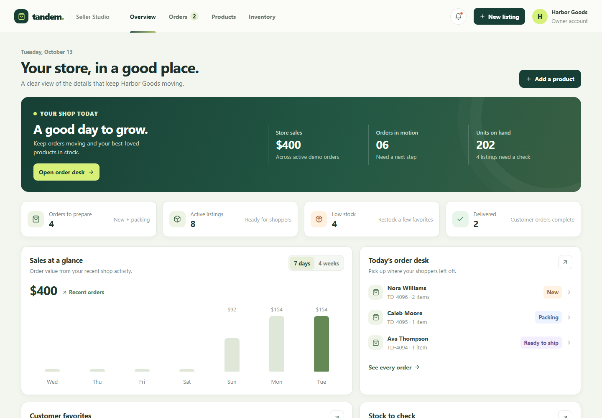

# Tandem Seller Studio

A frontend-only ecommerce seller workspace for keeping an independent store's orders, catalog, and stock moving together. Tandem uses realistic sample records and client-side interactions to demonstrate the seller workflow. It does not connect to a store backend, marketplace, payment provider, or shipping service.

- Live demo: [https://a2rp.github.io/ecommerce-seller-dashboard/](https://a2rp.github.io/ecommerce-seller-dashboard/)
- Repository: [github.com/a2rp/ecommerce-seller-dashboard](https://github.com/a2rp/ecommerce-seller-dashboard)

## Pages

| Page | Route | What you can do |
| --- | --- | --- |
| Overview | `/overview` | Review sales, open orders, units on hand, stock alerts, recent activity, and best-selling listings. Switch between the weekly and four-week sales views. |
| Orders | `/orders` | Search and filter the queue, sort by date or order value, inspect an order, move it through fulfilment, cancel it with confirmation, and export the visible results to CSV. |
| Products | `/products` | Search, filter, and sort listings; add or edit a listing with validation; inspect its details; and remove it after confirming. |
| Inventory | `/inventory` | Search and filter stock, sort listings by stock level, export a stock sheet, add stock, or reduce stock with a reason and quantity validation. |

## Included behavior

- The header links to all four pages, shows a store activity menu, and opens the new listing form from any page.
- Dashboard values and summary cards update from the shared React state when orders, products, or stock change.
- Orders move through New, Packing, Ready to ship, Shipped, and Delivered. Cancellation requires a custom confirmation dialog.
- Product forms validate required details and values. Product removal requires a confirmation dialog that names the listing.
- Inventory adjustments accept whole numbers, prevent reducing more units than are available, and report the adjustment reason.
- Search, filters, sorting, empty states, CSV downloads, toasts, dialogs, and responsive navigation work in the browser.
- Dialogs support keyboard use and focus management. Links and controls have hover and focus feedback.

## Demo data and limits

The app starts with seeded sample orders and listings. Changes are held in React state while the page is open, so they remain consistent across routes during that visit. Refreshing the browser restores the original sample data. Nothing is saved to local storage or sent to a server. CSV export downloads the current client-side results; it does not create a server report.

## Run locally

```sh
npm install
npm run dev
```

The Vite development server prints the local address when it starts.

## Checks

```sh
npm run lint
npm run build
```

## Deploy

The deploy script builds the app, copies the single-page entry to `dist/404.html` for GitHub Pages route fallback, then publishes `dist` to the `gh-pages` branch:

```sh
npm run deploy
```

Live demo: [https://a2rp.github.io/ecommerce-seller-dashboard/](https://a2rp.github.io/ecommerce-seller-dashboard/)

## Screenshots

The gallery shows the four app routes and the distinct product, order, and inventory dialog states.

### Pages

#### Overview


#### Orders

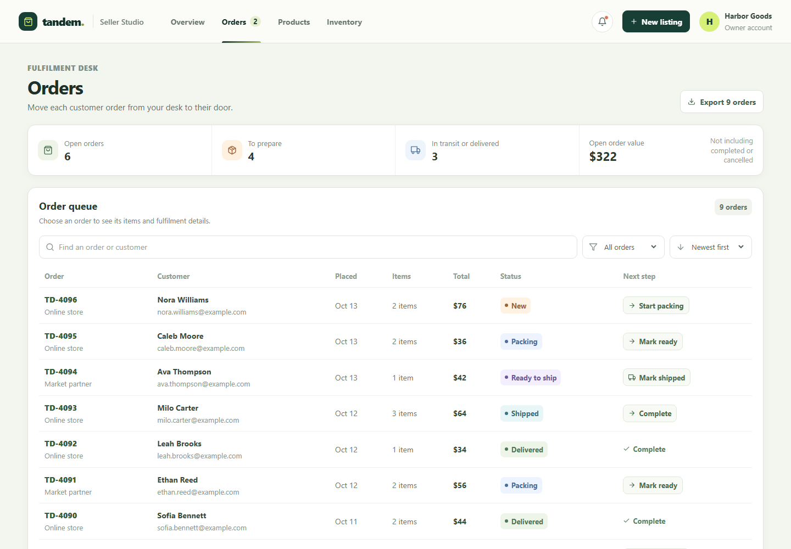

#### Products

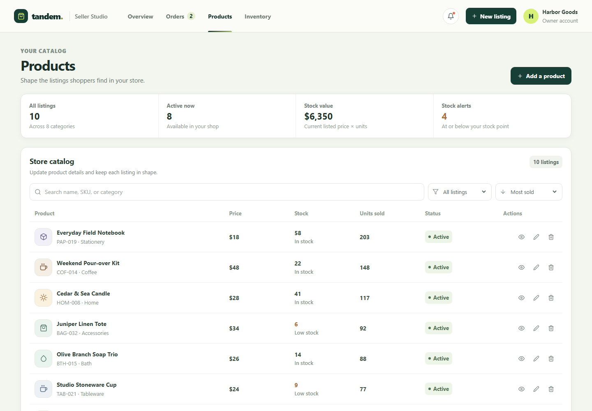

#### Inventory

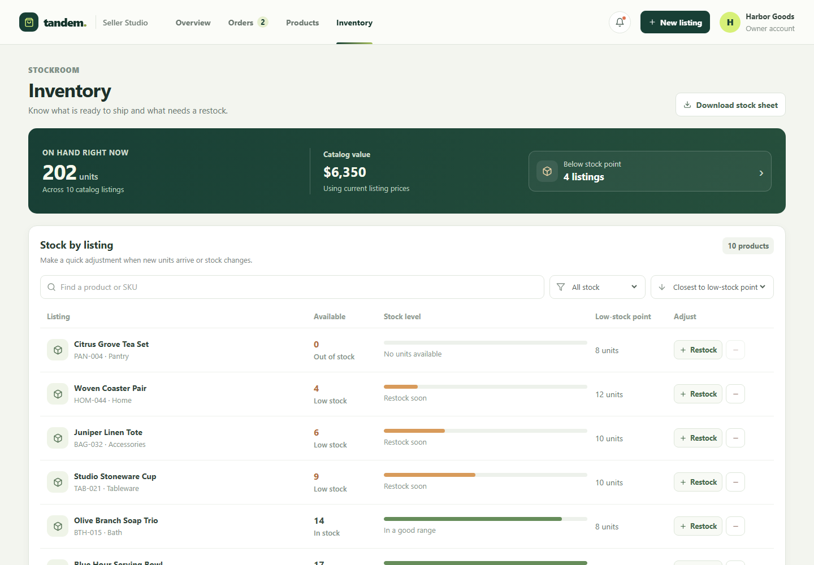

### Dialogs and validation

<details>
<summary>Add a product</summary>

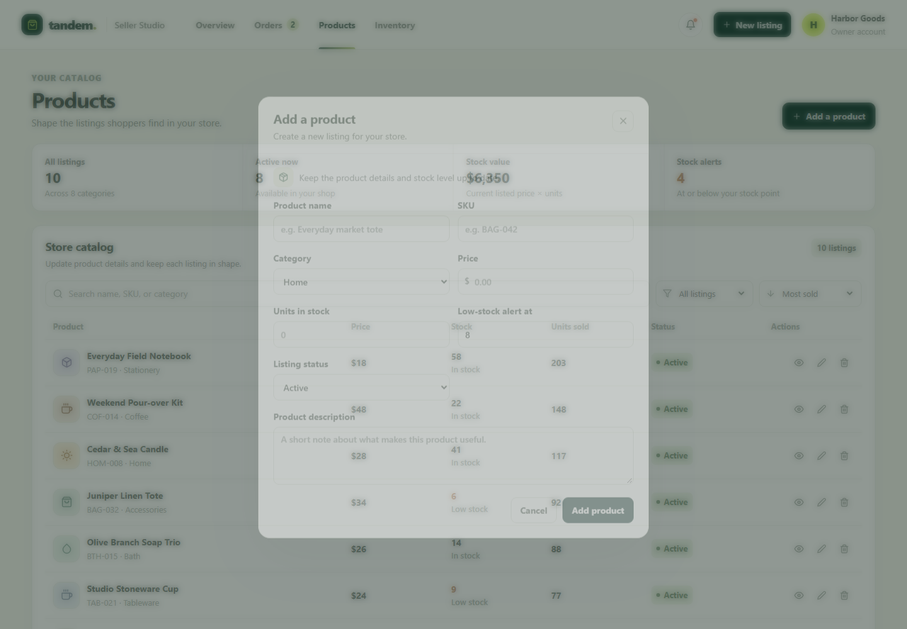
</details>

<details>
<summary>Product form validation</summary>

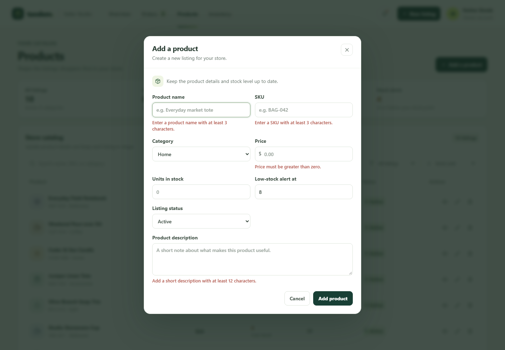
</details>

<details>
<summary>Edit a product</summary>

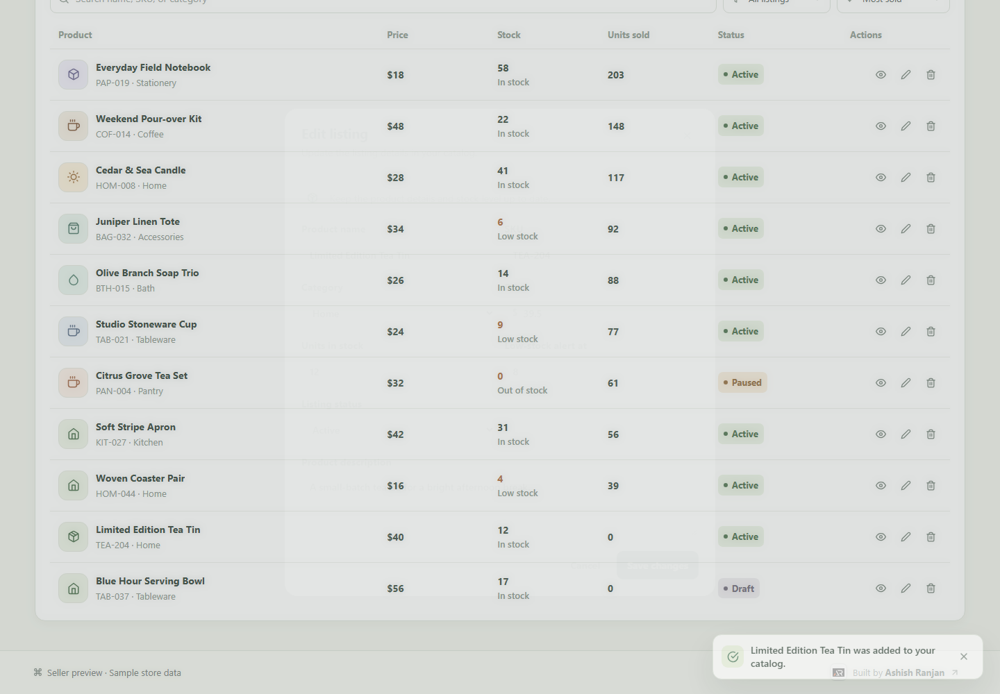
</details>

<details>
<summary>Product details</summary>

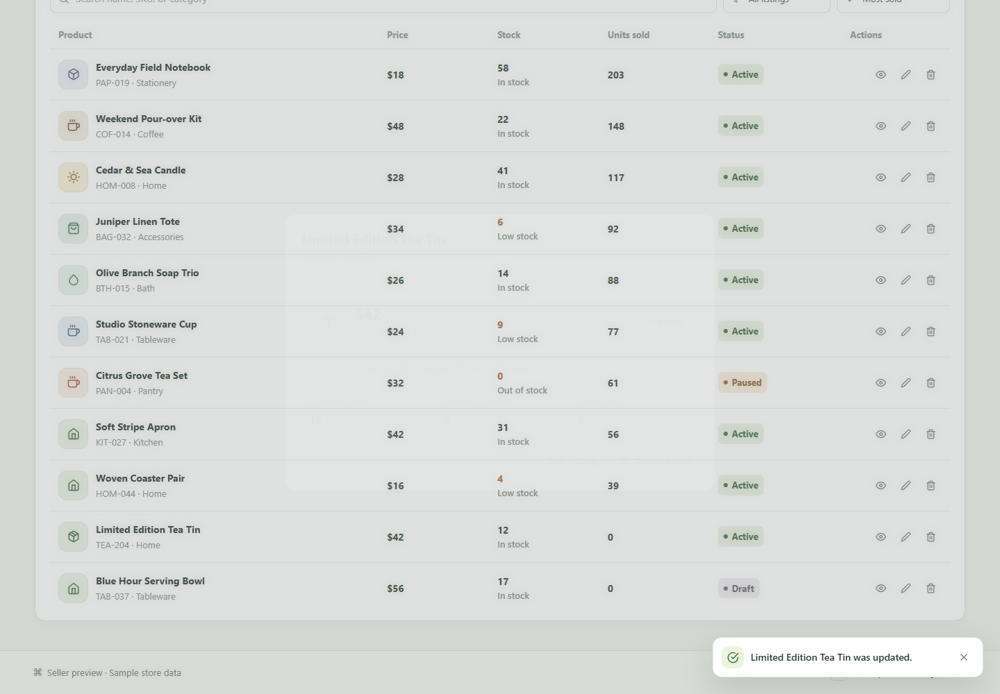
</details>

<details>
<summary>Remove product confirmation</summary>

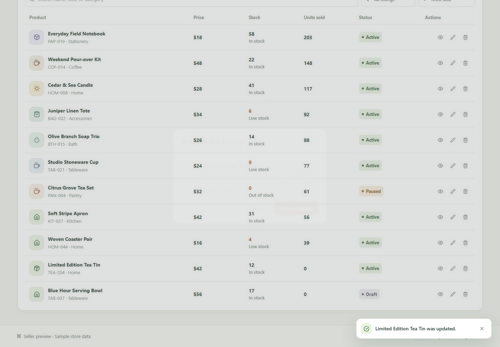
</details>

<details>
<summary>Order details</summary>

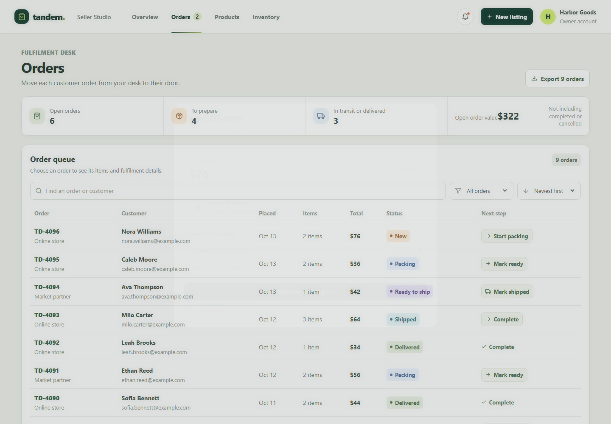
</details>

<details>
<summary>Cancel order confirmation</summary>

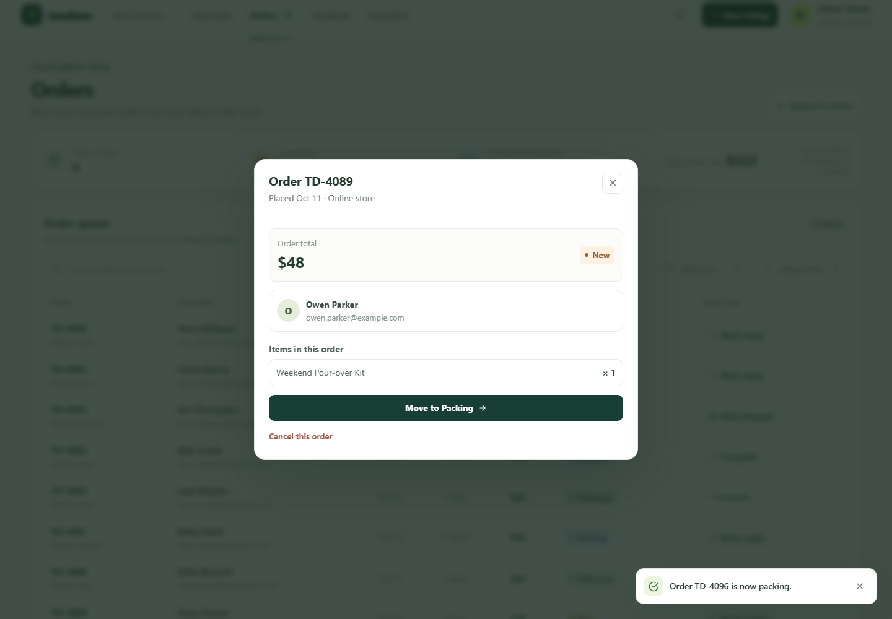
</details>

<details>
<summary>Add stock</summary>

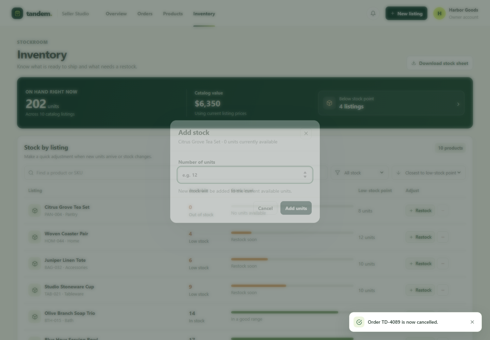
</details>

<details>
<summary>Stock quantity validation</summary>

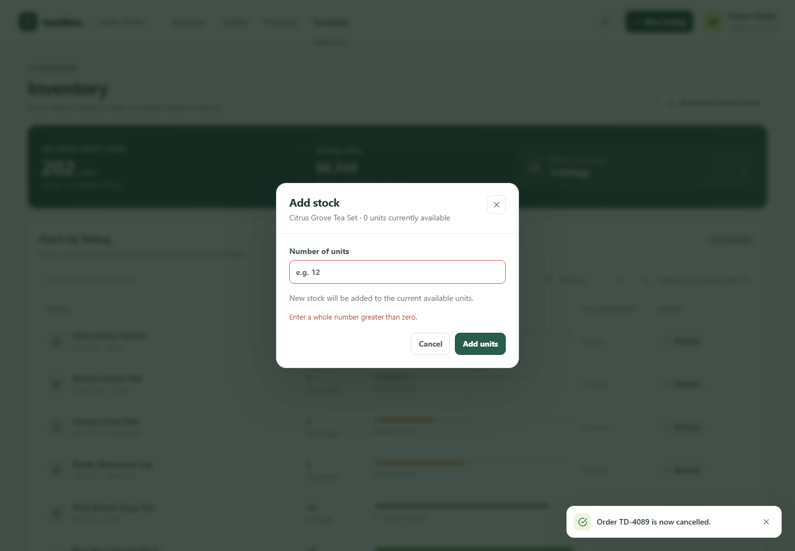
</details>

<details>
<summary>Reduce stock</summary>

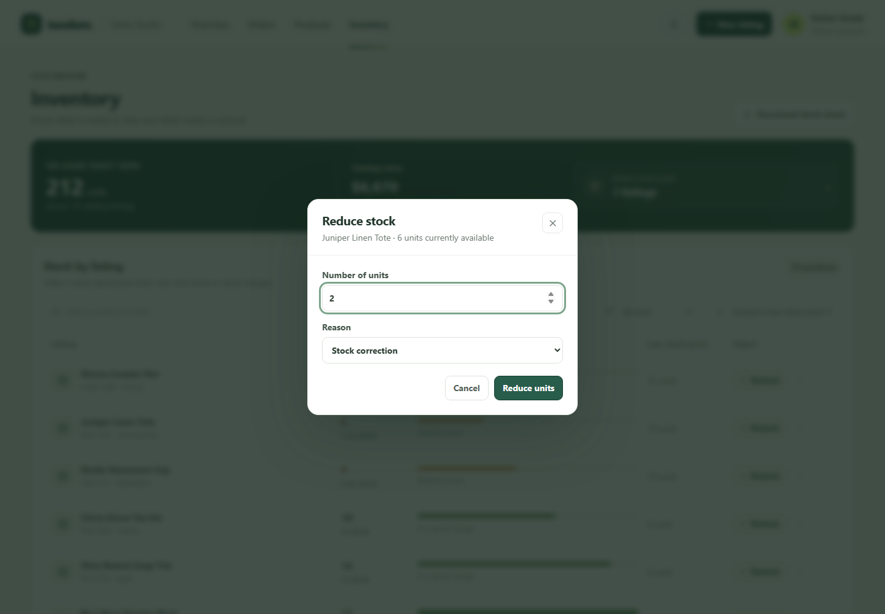
</details>

<details>
<summary>Reduce stock validation</summary>

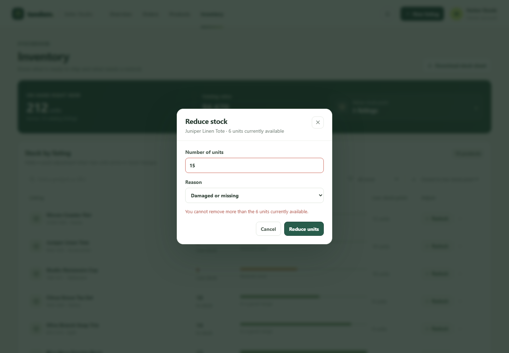
</details>

## Future improvements

These additions need shared services or external provider access and are not implemented in this frontend demo:

- Add a server-backed store workspace with accounts, role permissions, and shared catalog, order, and inventory data.
- Connect marketplaces and ecommerce platforms so listings and stock can synchronize across channels.
- Integrate shipping and payment providers for live labels, tracking, payouts, and settlement records.
- Keep durable audit history and sales reports on a backend so teams can review changes across sessions.

## Links

- Portfolio: [https://www.ashishranjan.net](https://www.ashishranjan.net)
- GitHub: [https://github.com/a2rp](https://github.com/a2rp)
- CodePen: [https://codepen.io/ash1198](https://codepen.io/ash1198)
- LinkedIn: [https://www.linkedin.com/in/aashishranjan](https://www.linkedin.com/in/aashishranjan)
- Facebook: [https://www.facebook.com/theash.ashish/](https://www.facebook.com/theash.ashish/)
- YouTube: [https://www.youtube.com/@ashishranjan-ashz?sub_confirmation=1](https://www.youtube.com/@ashishranjan-ashz?sub_confirmation=1)
- Email: [mailto:ash.ranjan09@gmail.com](mailto:ash.ranjan09@gmail.com)

## Support

- Support: [https://a2rp-donation-page.netlify.app/](https://a2rp-donation-page.netlify.app/)
- Buy Me a Coffee: [https://buymeacoffee.com/ashishranjan](https://buymeacoffee.com/ashishranjan)
- Patreon: [https://www.patreon.com/ashishranjan](https://www.patreon.com/ashishranjan)
